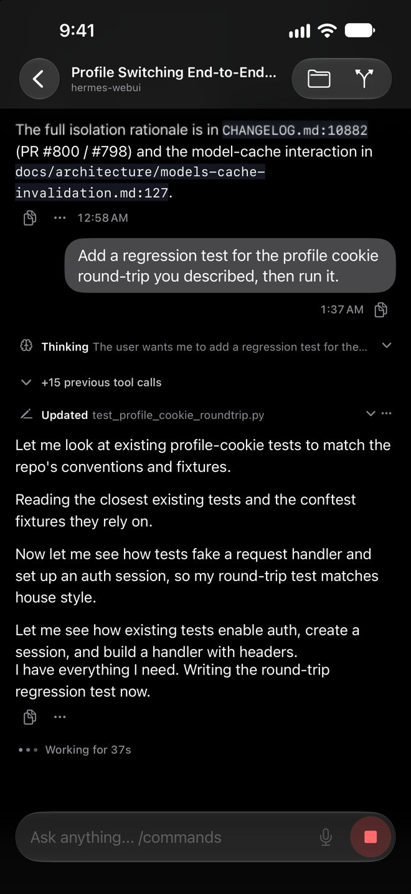
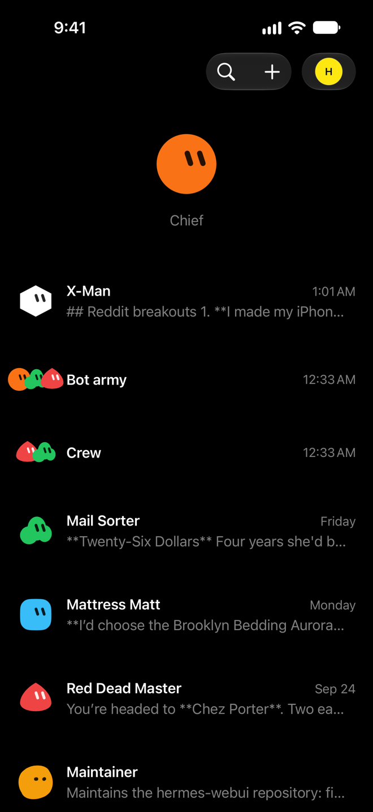
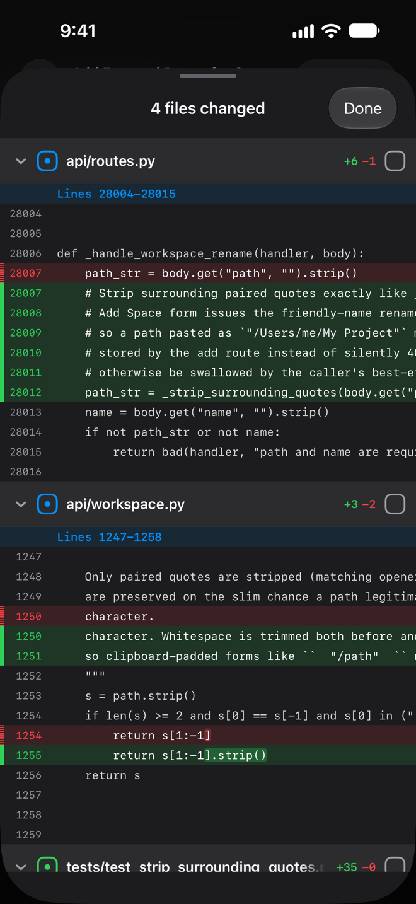
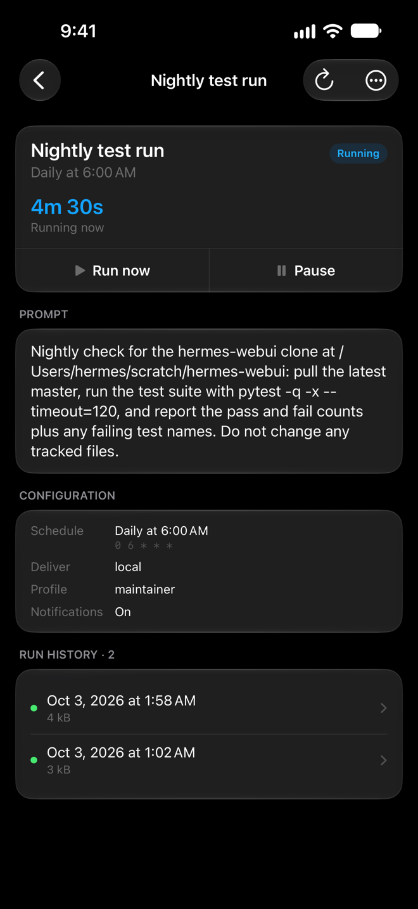

<div align="center">


# Hermex

**Run your self-hosted [Hermes](https://github.com/NousResearch/hermes-agent) agent from your iPhone and iPad.**

[](https://apps.apple.com/app/hermex/id6767006319)
[](https://swift.org)
[](LICENSE)
[](https://x.com/uzairansar)
[](https://buymeacoffee.com/callmeuzi)

<a href="https://apps.apple.com/app/hermex/id6767006319">
  
</a>

[Website](https://hermexapp.com) · [Setup guide](https://hermexapp.com/setup) · [App Store](https://apps.apple.com/app/hermex/id6767006319) · [Report a bug](https://github.com/uzairansaruzi/hermex/issues) · [Contributing](CONTRIBUTING.md)

<table>
  <tr>
    <td align="center"><br /><sub><b>Stream and steer work</b></sub></td>
    <td align="center"><br /><sub><b>Chat with your bots</b></sub></td>
    <td align="center"><br /><sub><b>Review and commit changes</b></sub></td>
    <td align="center"><br /><sub><b>Run scheduled Tasks</b></sub></td>
  </tr>
</table>

More screenshots are on [hermexapp.com](https://hermexapp.com).

</div>

Hermex is a native SwiftUI app for iPhone and iPad. It connects directly to a [Hermes Agent](https://github.com/NousResearch/hermes-agent) host that you run. From your phone, you start and steer sessions, follow streaming work, answer the agent's questions, and review what it changed. Your server runs the agent and its tools, holds your data, and calls the model providers you configure.

- **Free.** Hermex has no subscriptions and no in-app purchases.
- **Private.** Hermex has no analytics and no tracking. Agent traffic goes only to your server. Push notifications are optional and off until you turn them on. They pass through an open-source relay that you can host yourself, and the relay never sees message text, server URLs, or credentials. [`docs/agents/push.md`](docs/agents/push.md) lists the metadata the relay does see.
- **Native.** Hermex runs on iOS and iPadOS 18 or later, and it isn't a web wrapper.

## What you can do

On a Hermes server, Hermex gives you these features:

- **Chat.** Stream replies with the agent's thinking and tool calls. Steer or stop a run, answer approvals and questions, and attach images and documents. Pick the model, Profile, and reasoning effort from the composer.
- **Voice.** Dictate with the host's speech-to-text, and listen to replies in the host's voice.
- **Sessions.** Search, rename, pin, archive, branch, and export sessions, and group them into projects. Cached sessions stay readable offline.
- **Bots.** Chat with your Hermes bots one to one or in group chats.
- **Files and Git.** Browse and preview the session's workspace files. See the Git status, then stage, commit, push, and switch branches.
- **Tasks and Kanban.** Create scheduled Tasks, run them on demand, and read their run history. Manage Kanban boards and Cards with live updates.
- **Skills, Memory, and Usage.** Turn skills on and off, edit the agent's memory and soul, and read its usage.
- **Notifications and Live Activities.** Get a push when a reply finishes, and follow a run on the Lock Screen and in the Dynamic Island.
- **System integration.** Start chats from Shortcuts, and share files and text into a session from other apps. On iPad, the session list sits in a sidebar beside the open chat.
- **Multiple servers.** Add several servers and switch between them. Each server keeps its own sign-in, cache, and drafts.

## Getting started

Hermex is a client only. It doesn't ship, host, or provision a server. You run Hermes Agent on a machine you control, and you're responsible for securing it and keeping it reachable.

The [setup guide](https://hermexapp.com/setup) covers each step in detail.

1. Install Hermes Agent 0.21.3 or later. The [installation docs](https://hermes-agent.nousresearch.com/docs/getting-started/installation) cover Linux, macOS, WSL2, and native Windows. To update an existing install, run `hermes update`.
2. Start the dashboard with `hermes dashboard`. It listens on `127.0.0.1:9119`, so only that machine can reach it.
3. Make the dashboard reachable from your phone. [Make the server reachable](#make-the-server-reachable) lists the options.
4. In `~/.hermes/config.yaml`, set `dashboard.public_url` to the address your phone uses. Then restart the dashboard with `hermes dashboard --no-open`. If you chose another private network or the same Wi-Fi, add the same `--host` flag. When it asks how to sign in, choose **Username & password**.
5. Open [Hermex](https://apps.apple.com/app/hermex/id6767006319), enter the address, and tap **Connect**. Enter the dashboard's username and password, and tap **Connect** again.

To have your agent do steps 3 and 4 for you, send it the setup prompt from Hermex's onboarding. The agent asks before it adds a route, and it tells you before it restarts the dashboard. Hermex also signs in to dashboards that use browser sign-in.

### Make the server reachable

Pick one of these routes. Each one gives you the address you enter in Hermex.

- **Tailscale Serve (recommended).** Install Tailscale on the server machine and on your iPhone, and sign both in to the same tailnet. Leave the dashboard on `127.0.0.1` and run `tailscale serve --bg 9119`. Serve takes HTTPS port 443 at the root path. If the machine already serves something there, run `tailscale serve status` first so you don't replace it. Your address is the `https://<machine>.<tailnet>.ts.net` URL that `tailscale serve status` prints.
- **Cloudflare Tunnel behind Cloudflare Access.** A tunnel gives the dashboard a public HTTPS hostname without an open port. The dashboard's password sign-in isn't meant for the open internet, so put Cloudflare Access with a service token in front of it. When you connect in Hermex, choose **Cloudflare Tunnel** and paste the token's Client ID and Client Secret.
- **Another private network, such as NetBird.** Install its app on the iPhone and keep it connected. Start the dashboard with `--host` set to the machine's address on that network, and use that address.
- **Same Wi-Fi.** Start the dashboard with `--host 0.0.0.0` and use `http://<machine-ip>:9119`. The password then crosses your network unencrypted, so do this only on a network you trust.
- **Simulator only.** Use `http://localhost:9119` when the dashboard runs on the same Mac.

### Troubleshoot the connection

If Hermex can't connect, check these in order:

1. The server machine is awake, and the dashboard is running.
2. The tunnel, proxy, or Tailscale route is connected.
3. From another device, `curl https://<your-host>/api/status` returns `"auth_required": true`. Behind Cloudflare Access, add the service token's `CF-Access-Client-Id` and `CF-Access-Client-Secret` headers.
4. The address in Hermex matches the scheme and host in `dashboard.public_url`.
5. The username and password are correct.

If sign-in works but chats fail, check that your proxy forwards WebSocket connections.

## Server compatibility

Hermex signs in to Hermes 0.21.3 and later. On an older host, it asks you to update Hermes. Session edits and Move to Hermes need Hermes 0.22.3 or later.

We test each release against the `hermes-agent` commit in [`HERMES_AGENT_TESTED_SHA`](HERMES_AGENT_TESTED_SHA). Line 1 is the commit, and line 2 is the release that commit reports. Hermex decodes server responses tolerantly, so a field it doesn't know never crashes it. Include your Hermes version in bug reports.

Push notifications, Git fetch and pull, and provider limits in Usage need the open-source [hermex-push](https://github.com/uzairansaruzi/hermex-push) plugin on the host. Hermex installs the plugin when you turn on push for a server.

## Legacy hermes-webui servers

Hermex 1.x connected to [hermes-webui](https://github.com/nesquena/hermes-webui) servers. Those servers still work in Hermex 2.0 and still get fixes, but new features go to Hermes. Settings marks them **Legacy**.

- To keep using a webui server, sign in with its address and password as before. The [legacy setup guide](https://hermexapp.com/setup/webui) covers running it and making it reachable. A webui server listens on port 8787, and `curl https://<your-server>/health` checks that it's up.
- To switch to Hermes, use **Move to Hermes**. It copies a webui server's chats and drafts to a Hermes host. Push carries over when the Hermes host is the same Hermes install. Otherwise, turn notifications on again for the Hermes server. The webui server keeps working until you remove it.

The webui contract is pinned to the commit in [`UPSTREAM_TESTED_SHA`](UPSTREAM_TESTED_SHA). Upstream doesn't guarantee a stable API, so a newer or older server can break individual features.

## Build from source

Use the [App Store build](https://apps.apple.com/app/hermex/id6767006319) unless you're developing Hermex. To build it yourself, you need Xcode 27 and an iPhone, iPad, or simulator on iOS 18 or later. CI pins Xcode 27.0.

Open `HermesMobile.xcodeproj` and run the `HermesMobile` scheme. The Xcode target is `HermesMobile`, and the app's display name is Hermex. Xcode resolves the dependencies through Swift Package Manager.

To build from the command line, pick a simulator UDID from `xcrun simctl list devices available`:

```zsh
xcodebuild -project HermesMobile.xcodeproj -scheme HermesMobile -destination 'platform=iOS Simulator,id=<simulator-udid>' build
```

To run the tests, use the repository's test runner:

```zsh
scripts/test-sim <simulator-udid>
```

[`DEVELOPMENT.md`](DEVELOPMENT.md) covers the full local workflow, including signing and test logs. XcodeBuildMCP reads its defaults from `.xcodebuildmcp/config.yaml`.

## Documentation

- [`AGENTS.md`](AGENTS.md): the working agreement. It covers product boundaries, server-contract rules, locked dependencies, verification, and PR flow.
- [`CONTEXT.md`](CONTEXT.md): the project's vocabulary.
- [`DEVELOPMENT.md`](DEVELOPMENT.md): local development, server setup, and the maintainer release runbook.
- [`CHANGELOG.md`](CHANGELOG.md): what changed in each App Store release.
- [`docs/agents/hermes-server.md`](docs/agents/hermes-server.md): how Hermex signs in to a Hermes host and reconnects.
- [`docs/agents/push.md`](docs/agents/push.md): the push components and the data the relay sees.
- [`docs/agents/`](docs/agents): the other agent conventions and feature notes.
- [`TESTFLIGHT.md`](TESTFLIGHT.md): maintainer-only TestFlight and App Store Connect operations.
- [`SECURITY.md`](SECURITY.md): how to report a vulnerability.
- [GitHub Issues](https://github.com/uzairansaruzi/hermex/issues): the roadmap, active bugs, and feature requests.

## Contributing

Contributions are welcome. [`CONTRIBUTING.md`](CONTRIBUTING.md) explains how to pick up work and open a PR. [`AGENTS.md`](AGENTS.md) holds the rules coding agents follow in this repo. Read the [Code of Conduct](CODE_OF_CONDUCT.md) too. The rules that matter most:

- Never invent an endpoint, RPC method, or JSON shape. Verify it against upstream source or a running server.
- Decode every server model tolerantly, so an unknown field never crashes the app.
- Add no third-party dependency beyond the locked list in `AGENTS.md` without approval.
- Don't change Hermes Agent or hermes-webui from this repo.

## Support the project

Hermex is free and built in the open. If it's useful to you:

- Star this repo so others can find it.
- Follow [@uzairansar on X](https://x.com/uzairansar) for updates and dev logs.
- [Buy me a coffee](https://buymeacoffee.com/callmeuzi) to support development.
- [Join the Hermex Discord](https://discord.gg/xDQWBCG4DQ) for help, updates, and other users.
- [Become a member](https://buymeacoffee.com/callmeuzi/membership) for early TestFlight builds, the members-only Discord channels, and a vote on what gets built next.

<a href="https://buymeacoffee.com/callmeuzi"></a>

### Supporters

Hermex is funded by its members. Thank you.

**Patrons:** Robin Edwards

**Members:** Aaron Kaufer

**Founding members:** James Cross · Alexey

<sub>Updated monthly from [Buy Me a Coffee](https://buymeacoffee.com/callmeuzi/membership). Members who join anonymously aren't listed. Email [uzairansar@gmail.com](mailto:uzairansar@gmail.com) to be added or removed.</sub>

## License

MIT. See [LICENSE](LICENSE).

The file-type icons in the workspace tree are [Pierre](https://pierre.computer)'s `@pierre/trees` icons (Apache-2.0), with a few additions from [T3 Code](https://github.com/pingdotgg/t3code) (MIT).

Hermex is an independent client. It isn't affiliated with Nous Research, Hermes Agent, or the [hermes-webui](https://github.com/nesquena/hermes-webui) project. Apple, the Apple logo, and App Store are trademarks of Apple Inc.
